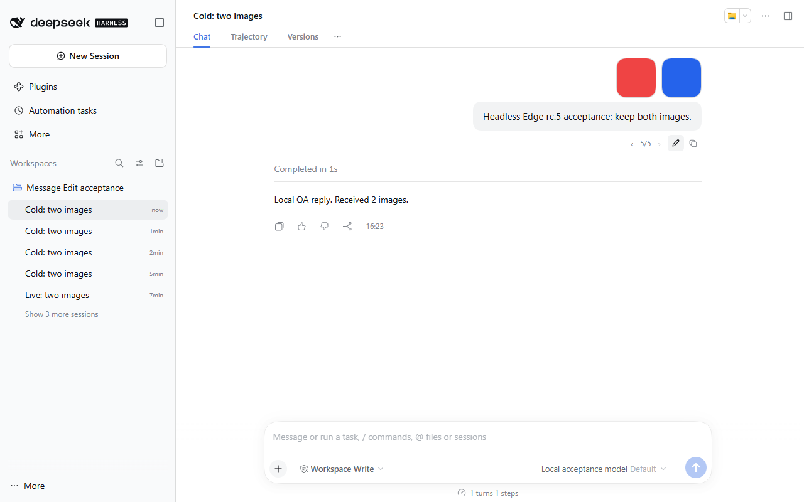
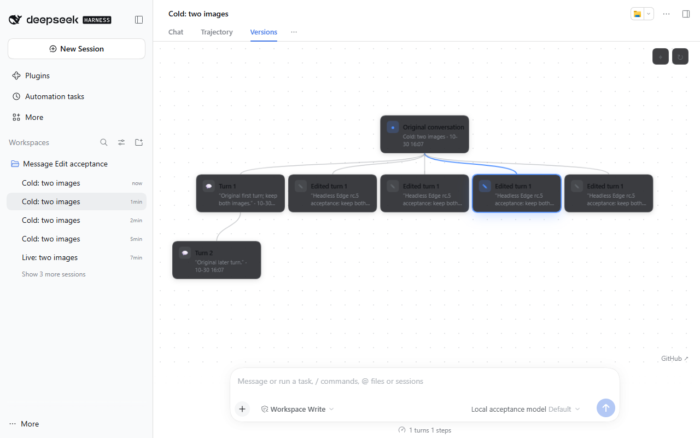
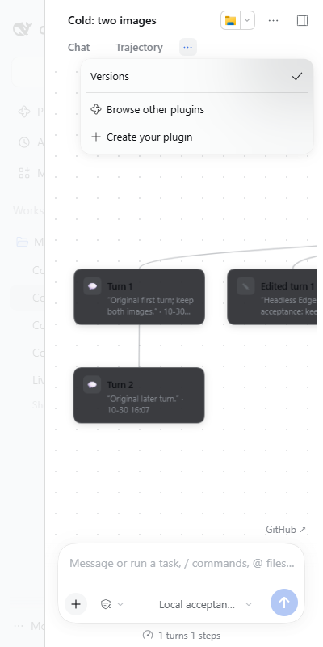

# Official DSH 0.2.1-rc.5 implementation acceptance

Event: `compatibility:message-edit:dsh-0.2.1-rc.5`.
Parent: `958082a1-5af9-4de3-b71e-662620ee8845`.
Date: 2026-10-30. Base: `e684880f3a9bac8865abc21920fe0a867d3cd101`.
Environment: Windows, Node 22.19.0, npm 10.9.3.

## Scope and upstream inspection

The previous range rejects `0.2.1-rc.5` under npm's default semver rules.
Before changes, `semver.satisfies` returned true for `0.2.0-rc.2` and
`0.2.1-rc.2`, false for `0.2.1-rc.5`; all 56 baseline tests passed.
Both package declarations (`peerDependencies` and `engines.dsh`) now explicitly
append `|| 0.2.1-rc.5`. Under default npm semver rules, earlier tested
prereleases are retained while excluding other untested 0.2.1 prereleases.
(At runtime, the host's `dsh-app-boot` uses `includePrerelease: true`, so the
host loader already runtime-loads rc.5 and other prereleases; the explicit
addition is required for npm peer dependency resolution.) The new test checks
acceptance, exclusions, and lockfile/declaration agreement under default npm
semver rules. No host/client implementation adaptation was needed in the
exercised flows. Bumping to version 1.5.0 with README compatibility updates
and release writing belongs to Writer.

Sources inspected:

- https://www.npmjs.com/package/@deepseek-ai/dsh
- https://github.com/deepseek-ai/deepseek-harness/releases/tag/dsh-v0.2.1-rc.5
- A shallow upstream checkout at tag commit
  `b830ec950faba0a46dda564be3e2d854afed94f1`, plus fetched tag `dsh-v0.2.1-rc.2`.
- Installed official npm rc.2 and rc.5 packages, without repository overrides
  in their separate runtime prefixes.

`npm view @deepseek-ai/dsh@0.2.1-rc.5 version gitHead dist.integrity dist.tarball engines --json`
reported version 0.2.1-rc.5 and integrity
`sha512-WkyJZv4zl9sCAxSzRctGm58m0rilGqwR6pniBiLOz5CPDfHfDuAUicg0AAazXI7oj/Cph6/cjNTncA/rpLTXpw==`.
It did not supply gitHead; tag identity and npm package identity were checked
separately, not treated as an npm source attestation.

Relevant upstream diff findings (rc.2 to rc.5):

- Session, agent, session-query, workspace, locale, renderer, and module-loader
  source directories have package version changes only. Their installed
  `lib/index.js` or client `lib/client.js` entries are byte-identical. This covers
  `snapshotEvents`, seeded creation/inbox setup, maintenance/cancellation,
  disposable `observeSession`, workspace attachment/unarchive, locale registration,
  and module/slot registration used here.
- Session-controller client changes are a comment. Workspace navigation changes
  concern blank-session creation/draft reuse; `openSession` used here is retained.
- Conversation views now support pinning/overflow through a More menu; the
  plugin's `conversation.view` registration remains valid.
- Chat reasoning body contracts changed, but the user node/content/image
  contracts used by this plugin did not.

## Automated commands and results

Run from the owned repository unless a prefix is shown:

```powershell
npm ci --no-audit --no-fund
npm install --package-lock-only --ignore-scripts --no-audit --no-fund
npm ci --no-audit --no-fund
npm test
npm run check:release-tools
node --test scripts/npm-publish.test.mjs
npm run check:package
npm ls semver @deepseek-ai/dsh @modelcontextprotocol/client @modelcontextprotocol/core --all
git diff --check
```

All pass: 57 tests, 4 release-helper tests, 10 publication-helper **unit tests**,
and a real npm pack lifecycle with 13 expected archive files. The build produces
the unchanged 81,671-byte client. No publication command was run. `npm ci`
validates the updated lockfile; dependency versions were retained, including
the checkout-only MCP client/core 2.3.0 override. `semver` is now an explicit
development dependency (the existing locked 7.8.5). The CI YAML was parsed with
the installed `yaml` module and its six host/OS combinations asserted; actionlint
was unavailable. Hosted CI/Linux/Node 24 were not run locally.

Task parent (all runtime prefixes and disposable homes belong to this event):

`C:/Users/charl/AppData/Local/Temp/opencode/dsh-rc5-message-edit-958082a1-8408a509`

Install commands from that parent:

```powershell
npm install --prefix ./runtime-rc5 --no-audit --no-fund --save-exact @deepseek-ai/dsh@0.2.1-rc.5
npm install --prefix ./runtime-rc2 --no-audit --no-fund --save-exact @deepseek-ai/dsh@0.2.1-rc.2
```

For each runtime, from `repo`, set `TEMP` and `TMP` to the task parent, set
`DSH_QA_MODULES` to the absolute prefix's `node_modules`, then run:

```powershell
node scripts/run-dsh-acceptance.mjs
```

Both official prefixes pass fresh and restart acceptance. The checkout's
`repo/node_modules` host (`0.2.0-rc.2`, with the repository MCP override) also
passes both phases. Logs are retained at task-parent `acceptance-rc5.log`,
`acceptance-rc2.log`, and `acceptance-020-rc2.log`.

Each run exercises live/cold source edit, two-image preservation, deterministic
local model replies, original-history preservation, exactly one replayed turn,
version markers/tree, sibling retry and nested turn-two branching. Restart now
explicitly requires a cold seeded branch and resumes/retries it; missing persisted
data can no longer silently skip that part of acceptance. The runner reports
version/PID/home/origin, forwards the phase, and removes its unique home afterward.
CI now runs these checks for all three versions on Windows and Linux.

## Browser evidence and limits

The official rc.5 Web host at `http://127.0.0.1:53235/` used a new disposable
home and the committed local fixture. In Poracode's isolated browser, verified:
live-source edit and automatic branch navigation; both image thumbnails; the
host's original-image dialog; previous-version navigation (2/2 to 1/2); tree
contents; Message Edit settings; Claude style selection and retry (3/3 with a
local reply). All ten captured `/message-tree` GET/POST requests returned 200.

Some automation steps needed fresh element refs after navigation; a guessed tree
selector and the README's old settings label did not match the rendered UI.
These were corrected by inspecting the actual page. Poracode eval was disabled,
and screenshot/console tools were absent from its callable catalog. Separate
headless Edge capture was used for screenshots and console/network assertions.
The first capture attempt expected the already-acknowledged preview notice;
the local capture script was corrected to handle its absence.
An early headless attempt clicked the version arrow before the host's completion
state settled. A user-visible limitation remains present: immediately after
submitting an edit on a live source, a first backward click on the version ring
can fail to navigate, logging `Session reference "..." is released` in the host
console while the superseded session reference settles; repeating the click or
waiting ~10s succeeds. Negative-control testing confirms this is pre-existing
behavior on official rc.2 rather than an rc.5 regression; not all first-click ring
checks pass unconditionally. Waiting for `/qa/state` and the Send control
settled resolved subsequent navigation.
At 700px Versions remained a visible tab, so expecting it in the More menu was
an incorrect test assumption. Narrow overflow was checked separately at 400px.

Visual limitation: the existing tree card/tool styles use a dark fallback for
`--dsw-alias-bg-primary` in light mode, producing poor title contrast. This CSS
is unchanged from the base (plugin.client.js lines 794/807); the relevant upstream
theme source also has no rc.2-to-rc.5 change. This event does not establish a new
rc.5 regression or fix that pre-existing appearance issue. Initial screenshots
also caught spring animation in flight; final tree capture waits for nonoverlap.

Final `node capture-browser.mjs` passes in headless Edge `156.0.4314.50`, using
`playwright-core` installed only in task-parent `browser-tools`. It submits an
edit from the cold fixture, waits for host completion and two decoded 360px
images, opens the native image viewer, switches to a previous sibling, verifies
nonoverlapping tree cards, and opens Versions through the 400px header More menu.
Zero console/page errors, zero failed requests/HTTP errors; all four captured
message-tree requests (including POST) return 200. Machine-readable results:
task-parent `browser-evidence.json`. Reruns created additional disposable sibling
branches; the final screenshots show these honestly.





No native DSH desktop application or real remote model was exercised. The fixture
uses the real host/agents/persistence with an in-process deterministic adapter;
this does not validate provider authentication, remote streaming, or telemetry.

## Owned resources

Automated acceptance host PIDs (all stopped by the runner): rc.5 `58364`, `58108`;
rc.2 `31896`, `96888`; checkout 0.2.0-rc.2 `102824`, `98704`.
Their homes `message-edit-dsh-qa-ogFnMI`, `message-edit-dsh-qa-90tVvh`, and
`message-edit-dsh-qa-TdQAT7` were removed by the runner.
Browser QA host PID `98136`, home `message-edit-dsh-qa-browser-FTCnVh`.
PID 98136 was stopped after capture; all seven listed host PIDs are absent.
Headless browsers closed in `finally`; no node/Edge processes with this task
parent in their command line remained. The owned Poracode tab was closed and
browser control disabled. The stopped browser home is retained for inspection.
Task-only helpers `browser-qa.mjs` and `capture-browser.mjs`, runtime prefixes,
upstream checkout, and logs are retained under the task parent for independent
review. No user's DSH profile, main checkout, or shared worktree was changed.
