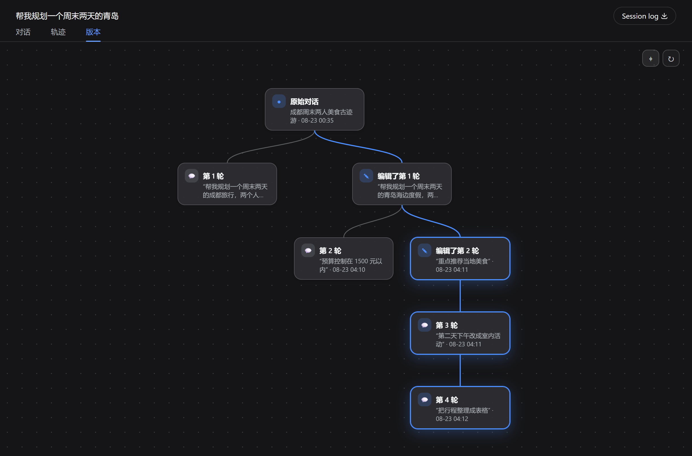

# dsh-plugin-message-edit

[English](README.en.md) | 简体中文

[](https://www.npmjs.com/package/dsh-plugin-message-edit)
[](https://github.com/SpookySandwich/dsh-plugin-message-edit/actions/workflows/ci.yml)
[](LICENSE)
[](https://github.com/deepseek-ai/deepseek-harness)
[](https://github.com/SpookySandwich/dsh-plugin-message-edit/stargazers)

编辑一条已经发出的消息，对话会从那一刻 **真正回溯并分叉**——和 ChatGPT、Claude、DeepSeek 的做法一致。旧版本不会被覆盖：气泡下方出现 `‹ 2/4 ›` 计数，「版本」标签页则画出整棵树。


## 版本树分支展示

无论对话如何深层分叉、编辑多少次，「版本」标签页均会呈现清晰的轮次级分支图，当前会话所在路径实时高亮，点击任意节点即可平滑跳转：



## 功能

- **编辑并分叉**：修改过去的提问并发送，新分支会带着该轮 *之前* 的完整上下文重新生成。这是真正的回溯，而不是从末尾继续的 fork。
- **版本计数**：一条消息存在多个版本时，下方出现 `‹ n/m ›`，左右箭头在各版本间即时切换。
- **版本树**：新增「版本」标签页，以图的方式展示所有分支，可平移、缩放、拖动。当前所在分支高亮，点击任意节点即可跳转。
- **零延迟与即时切换**：客户端家族级 SWR 缓存与乐观预加载，点击箭头或树节点切换版本 0ms 响应，无指示器闪烁或加载白屏。
- **高性能内存缓存**：宿主端内存解析缓存，消除重复磁盘 I/O 与日志重析，即便是深度分叉的庞大家族树也能毫秒级响应。
- **自动中止旧分支**：分叉时自动停止同家族中仍在流式生成的回复，避免浪费 Token 与计算资源。
- **重试**：不修改内容，直接重跑该轮（Claude 布局）。
- **复制**：把消息文本复制到剪贴板。
- **持久可靠**：每个分支都是真实会话，版本关系写入持久事件，重启后依旧完整。新分支自动归入父会话的工作区。

## 界面风格

在 **设置 → 消息编辑** 中开启「侧栏同一对话只显示一个入口」，即可将带记录谱系的原始会话及其编辑/重试分支合并为一个侧栏入口，搜索结果也会按家族去重。该选项**默认关闭**，保留原有列表行为。

- **合并范围与谱系边界**：每个具有记录父子谱系的版本家族合并为原始根会话一行，所有分支节点仍完整保留在「版本」标签页与气泡下方的 `‹ n/m ›` 切换器中。宿主原生的独立复制会话（例如 DSH `0.2.2-rc.1` 的「分支为新对话」，有意不记录父会话谱系）保持为独立的根入口；找不到父会话的孤立分支仍单独显示，子智能体不会并入普通会话版本。
- **根会话归属与活动聚合**：合并入口保留原始根会话的真实标题、所属工作区、置顶状态与归档状态；在合并入口上执行置顶或归档仅作用于根会话本身（不会批量归档、删除或改写家族中的其他分支）。家族内各分支的最近活动时间、运行状态与运行中子智能体计数（`runningChildCount`）会汇总显示在合并入口上，查看任一子分支时仍高亮选中同一入口。
- **待处理状态与点击跳转优先级**：合并入口投射的状态标记与普通点击跳转使用同一组符合条件的可见未归档普通成员（同一优先级内优先选择原始根会话，其次按宿主目录顺序）：
  1. **待处理交互**（`approval` 审批、`plan-review` 计划审阅或 `question` 提问）最高优先；
  2. **未读完成状态**（`Completed`）次之；
  3. **记住的未归档版本**（开启「记住我正在查看的版本」时）或**原始根会话**兜底。
  当家族内存在待处理或未读完成状态时，点击入口会优先跳转到触发该状态的版本（临时优先于「记住我正在查看的版本」），确保隐藏分支的交互请求与未读完成状态可直接触达；宿主仅对实际打开的那个会话进行已读确认（不会整族批量标为已读），若多个分支同时存在未读完成状态，连续点击入口即可逐个访问并清除。
- **搜索命中跳转与已知限制**：在搜索结果中点击带有匹配正文摘要（或唯一命中隐藏分支）的结果时，会直接打开命中的具体版本（优先于待处理/未读状态与记住的版本）：
  1. 在「显示已归档」（`All conversations`）视图下，若根会话未归档而仅有已归档的隐藏分支命中搜索正文，合并结果会沿用根会话的未归档外观且不显示行内取消归档按钮；点击该结果会清空搜索词并提示宿主原生的已归档限制（「已归档的会话无法打开，请先取消归档」），不会发生跳转或自动取消归档。请通过「版本」标签页或关闭合并后的原生列表取消该分支归档。
  2. 当全文搜索（FTS）关闭且多个隐藏分支共享匹配的标题（而根会话标题不匹配）时，点击去重后的家族搜索结果会打开其中一个匹配分支（首个符合条件的匹配项），不一定优先打开之前记住的版本。
  3. 在旧版宿主（`0.2.0-rc.2`、`0.2.1-rc.2`、`0.2.1-rc.5`）上，开启合并时回退搜索可匹配隐藏分支的会话 ID，但宿主原生搜索本身不支持普通/根会话 ID 搜索；DSH `0.2.2-rc.1` 已原生支持所有会话的 ID 搜索。

这三家界面的差别在于 **操作按钮放在哪里、有哪些**，因此预设只改变这一点，颜色始终沿用 DSH 原生配色。在 **设置 → 消息树** 中选择，面板内有实时预览。

| 预设 | 气泡下方的按钮 | 显示方式 | 编辑框按钮 |
| --- | --- | --- | --- |
| **ChatGPT** | 编辑、复制 | 悬停时显示 | `取消` / `发送` 在框 **内部** |
| **DeepSeek** | 编辑、复制 | 始终显示——与 DSH 一致 | `取消` / `发送` 在框 **内部** |
| **Claude** | **重试**、编辑、复制 | 悬停时显示 | `取消` / `保存` 在框 **下方** |

只有 Claude 在用户消息上提供重试，与真实界面一致。没有分享按钮——DSH 本身没有，就不自行发明。

## 安装

```bash
dsh plugin --profile web add dsh-plugin-message-edit
```

安装后请重启 DSH：宿主端随服务器加载。界面跟随 DSH 显示语言（中文 / English / Русский）。可在语言选择器中选择俄语；宿主中尚未翻译的界面使用英语。

## 工作原理

DSH 的会话是仅追加的事件日志，本身不支持会话内分支，因此回溯需要另行实现：

- 宿主端提供 `/message-tree` 接口。编辑消息时，会 **以目标轮次之前的全部事件为种子创建一个新会话**，写入持久的 `message-tree/version` 标记说明改动内容，并把编辑后的提问送入。
- 之后读取这些标记，还原出整棵版本树、`‹ n/m ›` 计数，以及当前处于哪个分支。
- 标记事件带有信封上的 `ignorable` 标志。插件自定义的事件类型不在宿主的事件词表内，缺少该标志时读取端会拒绝解释整份日志，会话将直接打不开。
- 只遮蔽普通的 `user` 消息节点（优先级 `-1`）；思考、工具调用与引导消息仍由宿主渲染。

宿主端的分支逻辑源自 [dsh-message-edit](https://github.com/Moeblack/dsh-message-edit)（MIT © Moeblack），在其基础上重做为 ChatGPT 式回溯语义、同级分支展开，以及上述界面预设。

两者名字相近，这里说明一下：这是另一个独立插件。它的路由、cordis id 与持久事件类型都保留了 `message-tree` 这一套命名，正是为了两个插件可以同时安装而互不冲突。

## 文档

更多技术细节与开发指南，请参阅：
- [架构概览 (Architecture)](docs/ARCHITECTURE.md)：宿主/客户端架构、Cordis 服务注入、持久事件模型与 HTTP 接口。
- [树数据模型与算法 (Tree Data Model)](docs/TREE_DATA_MODEL.md)：轮次级消息树构建、同级展开、删除会话（Ghost）桥接与高亮路径计算。
- [开发与测试指南 (Development)](docs/DEVELOPMENT.md)：构建流程、单元测试与本地安装说明。

## 兼容性

版本 `1.6.1`（当前源码）：支持官方 DSH `0.2.2-rc.3`。编辑或重试没有活动智能体的导入历史时，若日志中不存在 `request/header`，则使用 DSH 当前默认模型；原生历史仍沿用已记录的模型与控制选项。源会话没有记录智能体预设时，分支会解析并挂载 DSH 配置的默认预设，保留其角色设定、指令与工具；导入会话追加原生轮次后同样适用。原生和导入消息中的文件卡片（包括仅有元数据的文件）与图片一起交由宿主内容渲染器显示。兼容范围显式纳入 `0.2.2-rc.3`，继续排除尚未验证的 `0.2.2-rc.2` 与后续预发布版本。

版本 `1.6.0`：新增可选的「侧栏同一对话只显示一个入口」版本合并功能（[#12](https://github.com/SpookySandwich/dsh-plugin-message-edit/pull/12)，由 [@ganpig](https://github.com/ganpig) 贡献），并支持官方 DSH `0.2.2-rc.1`（上游标签 `dsh-v0.2.2-rc.1`，提交 `66491b05e3f05ad35bcdd4f6cd7ed26041d9e3db`），同时保持对 `0.2.0-rc.2`、`0.2.1-rc.2` 与 `0.2.1-rc.5` 的兼容支持。声明的宿主兼容范围（`peerDependencies` 与 `engines.dsh`）显式纳入 `0.2.2-rc.1`（`>=0.2.0-rc.2 <0.3.0-0 || 0.2.1-rc.2 || 0.2.1-rc.5 || 0.2.2-rc.1`）。官方 DSH `0.2.2-rc.1` 要求 Node `>=24.9.0`，本插件对旧版受支持 DSH 宿主继续保持 Node `22.19+` 与 Node `24` 兼容，未在 `package.json` 中额外抬高全局 Node 版本下限。包含按记录谱系合并侧栏入口（默认关闭）、根会话工作区/置顶/归档归属保持、家族运行状态与子智能体计数聚合、待处理与未读状态优先跳转（`approval`/`plan-review`/`question` → 未读完成 → 记住的版本/根会话兜底，按实际打开会话逐个确认已读）、显式搜索摘要命中跳转、流式输出期间稳定的搜索回调、DSH `0.2.2` 用户消息正文选择引用（Quote）标记，以及浅色主题下版本卡片与控件背景对比度修复（`--dsw-alias-bg-base`）。已完成 102 项自动化测试、发布与打包校验、官方 `0.2.0-rc.2`、`0.2.1-rc.2`、`0.2.1-rc.5` 与 `0.2.2-rc.1` 四版本全新启动与重启恢复 API 验收，以及官方 `0.2.2-rc.1` 与 `0.2.1-rc.5` 真实浏览器隔离 Web 验收。

版本 `1.5.0`：支持官方 DSH `0.2.1-rc.5`，同时保持对 `0.2.0-rc.2` 与 `0.2.1-rc.2` 的兼容支持。声明的宿主兼容范围（`peerDependencies` 与 `engines.dsh`）显式纳入 `0.2.1-rc.5`（`>=0.2.0-rc.2 <0.3.0-0 || 0.2.1-rc.2 || 0.2.1-rc.5`）。在官方 `0.2.0-rc.2`、`0.2.1-rc.2` 与 `0.2.1-rc.5` 运行时上完成全新启动与重启恢复验证，涵盖多图消息编辑、版本导航、重试分叉以及 400px 窄屏 More 菜单导航。

版本 `1.4.1`：在仓库检出环境的 `overrides` 与锁文件中将 `@deepseek-ai/dsh-mcp-client` 的 `@modelcontextprotocol/client`（及 `@modelcontextprotocol/core`）固定为 `2.3.0`，覆盖 [GHSA-6qxp-vccf-f47h](https://github.com/advisories/GHSA-6qxp-vccf-f47h)（`CVE-2026-104850`，`2.2.0` 修复）与 [GHSA-6prh-2h8m-c8cw](https://github.com/advisories/GHSA-6prh-2h8m-c8cw)（`CVE-2026-111769`，跨源重定向转发自定义请求头与 `307`/`308` 请求体，`2.3.0` 修复；`2.3.0` 在 Node 下仅跟随同源重定向，依赖跨源重定向的 MCP 服务端需配置最终 URL）。该变更仅加固本仓库开发/测试检出环境；npm 作为依赖安装时会忽略 `overrides` 且发布包不含 `package-lock.json`，安装或更新本插件不会修改用户现有 DSH 宿主依赖。

版本 `1.4.0`：新增俄语（`ru` / `Русский`）客户端本地化（完整覆盖全部 37 条界面与图片文案），并在宿主语言选择器中注册 `Русский`（宿主未翻译界面回退至英语；若未显式保存语言偏好且浏览器语言顺序将俄语排在中文之前，自动检测会选中俄语并将未翻译宿主界面回退为英语；预加载的 `ru` 语言包会被优先保留，若外部 `ru` 语言包在本插件之后加载则会因重复注册冲突）。

版本 `1.3.1`：当宿主不再传入旧版 `renderMessageImages` 回调时，通过宿主 `conversation.chat.user.content` 工厂恢复用户消息图片与原图预览，并提供基于 `loadImage` / `loadImage.peek` 的异步缩略图兜底。

版本 `1.3.0`：在兼容范围中显式纳入官方 dsh `0.2.1-rc.2`，并在官方 `0.2.0-rc.2` 与 `0.2.1-rc.2` 运行时验证编辑、重试与重启恢复。

版本 `1.2.1`：修复 DSH 0.2 客户端加载，编辑、重试及版本切换改用 `uiWorkspace.openSession` 导航。

版本 `1.2.0`：在官方 dsh `0.2.0-rc.2` 上通过 `workspaceRegistry.unarchiveSession` 取消版本归档。

版本 `1.1.0`：修复编辑/重试的 seed 边界，发布分支前清空继承的待发送输入，按会话身份识别版本标记，保留推理强度，并通过会话观察接口恢复持久分支。

声明兼容范围为 `>=0.2.0-rc.2 <0.3.0-0 || 0.2.1-rc.2 || 0.2.1-rc.5 || 0.2.2-rc.1 || 0.2.2-rc.3`；官方 dsh `0.2.0-rc.2`、`0.2.1-rc.2`、`0.2.1-rc.5`、`0.2.2-rc.1` 与 `0.2.2-rc.3` 满足该范围。旧版 DSH 请保留上一插件版本。[验证记录](.github/reviews/pr12-round2-actionable-status-2026-11-07.md)（[运行时矩阵](.github/reviews/pr12-current-runtime-2026-11-07.md)）。

已发布版本可从 [npm](https://www.npmjs.com/package/dsh-plugin-message-edit) 安装。测试当前源码时，先运行 `npm ci` 和 `npm pack`，再运行 `dsh plugin --profile desktop add ./dsh-plugin-message-edit-1.6.1.tgz`。发布完整性检查见 [发布流程](.github/RELEASING.md)。

`1.1.0` 已在 DSH `0.1.5-rc.2` 的隔离 Web 环境验证：插件加载、图片显示、编辑与重试、深层分支，以及持久会话的恢复读取。模型回复使用本地测试实现，未调用远程模型服务。

兼容层保留了旧版 `events` / `seedLength` 接口支持，并由自动测试覆盖。当前源码对应官方 dsh `0.2.2-rc.3`。更新插件后请重启 DSH。

可与 [dsh-plugin-smooth-stream](https://github.com/SpookySandwich/dsh-plugin-smooth-stream)、[dsh-plugin-rollout-scout](https://github.com/SpookySandwich/dsh-plugin-rollout-scout) 共存。

## 许可

MIT © SpookySandwich。宿主端部分逻辑源自 dsh-message-edit（MIT © Moeblack）。
